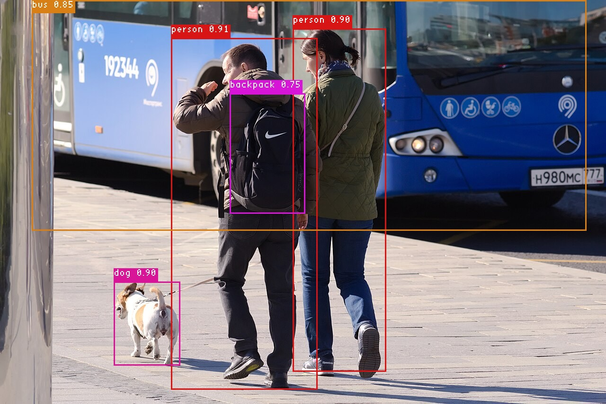

# YOLOX example

One small C host that runs the official **YOLOX** object detector on **any OAAX 2.0 runtime**: CPU, Intel, NVIDIA, DEEPX, Hailo, ...
You pick the runtime library, the model converted for it and the device; the host prints the runtime's name, the
detections and draws them on the image.



- **Standard model**: the official `yolox_s.onnx` of the YOLOX authors (80 COCO classes, no NMS inside, so every
  toolchain can convert it).
- **One host for every chip**: what differs between runtimes is a flag, not code (below).
- **No dependencies**: a C compiler and CMake. The image code is two single-header libraries, included in `third_party/`.

## Quick start (CPU)

```bash
sudo apt-get install -y cmake build-essential           # Ubuntu; nothing else is needed
cmake -S . -B build && cmake --build build              # builds build/yolox_host
bash fetch_model.sh                                     # models/yolox_s.onnx, sha256 checked
uvx oaax-manager fetch runtime cpu                      # the CPU runtime, see https://docs.oaax.org
./build/yolox_host runtime-cpu-2.0.0-linux-x86_64/libRuntimeLibrary.so models/yolox_s.onnx artifacts/street.jpg
```

Output (the CPU runtime takes the `.onnx` directly; numbers are from the machine described under
[Tested](#tested)):

```
Runtime: OAAX CPU Runtime 2.0.0
Runtime info: {"loaded_models":1,"requests_in_flight":0,"backend_version":"1.17.3"}
Input: 'images' float32 NCHW, 1280x854 image letterboxed to 640
Output tensor 'output': type 1, shape [1, 8400, 85]
Detections (score >= 0.30, NMS IoU 0.45): 5
  person         0.906  ( 361,   81) - ( 672,  824)
  person         0.903  ( 619,   61) - ( 816,  786)
  dog            0.903  ( 240,  596) - ( 381,  774)
  bus            0.853  (  68,    1) - (1239,  488)
  backpack       0.749  ( 485,  198) - ( 646,  453)
Wrote detections.png
OK: 10 requests, first 79.4 ms (warm-up), then 74.5 ms on average (min 68.9 ms)
```

`detections.png` is the picture above. The host exits with a non-zero code if any request fails.

## Usage

```
yolox_host <runtime library> <model> <image> [options]
```

| Option | Default | Meaning |
| --- | --- | --- |
| `--config KEY=VALUE` | `log_level=3`, `log_file=runtime.log` | Option for `runtime_init`; repeat it for several. This is how you choose a device or tune a runtime, e.g. `--config device_type=GPU`. Keys are runtime specific, see its page; unknown keys are ignored. |
| `--runs N` | `10` | Inference requests, sent one after the other. The first one includes the warm-up. |
| `--timeout MS` | `30000` | Wait for each output. |
| `--input-name NAME` | `images` | Name of the model's input tensor. |
| `--layout nchw\|nhwc` | `nchw` | Layout of the input. |
| `--dtype float32\|float16\|uint8` | `float32` | Type of the input. The values are always the raw 0-255 pixels. |
| `--size N` | `640` | Model input size, a multiple of 32: `640` for `yolox_s`, `416` for `yolox_tiny` and `yolox_nano`. |
| `--conf X` | `0.3` | Minimum score (objectness x class score). |
| `--nms X` | `0.45` | IoU above which a box of the same class is dropped. |
| `--output FILE` | `detections.png` | Picture with the detections; `.png` or `.jpg`; empty for none. |

The input flags describe **the converted model**, which the toolchain of a chip may change (see the table below).
If a runtime accepts a request but never answers (`NO_OUTPUT_AVAILABLE`, e.g. a wrong `--input-name`), the host says
which flags to check; the runtime's reason is in its log (`runtime.log` or the terminal).

## Per chip

Run everything from this directory, after the build and `bash fetch_model.sh` of the quick start. Runtimes and toolchains
come from [`oaax-manager`](https://github.com/OAAX-standard/oaax-manager); a toolchain is a Docker image
(`docker load -i <tar>`). `zip` is needed where a toolchain takes a zip (`sudo apt-get install -y zip`).

| Chip | Converted model | Input of the converted model | Flags |
| --- | --- | --- | --- |
| [CPU](#cpu) | `.onnx` (the toolchain is optional) | float32 NCHW | none |
| [Intel](#intel) | `.zip` (OpenVINO IR) | float32 NCHW with the config below, **float16** NCHW by default | `--config device_type=CPU\|GPU\|NPU`, `--dtype float16` for the default conversion |
| [NVIDIA ONNX Runtime](#nvidia) | `.onnx` | float32 NCHW | none |
| [NVIDIA TensorRT](#nvidia) | `.trt` engine | float32 NCHW | none |
| [DEEPX](#deepx) | `.dxnn` | **uint8 NHWC** | `--layout nhwc --dtype uint8` |
| [Hailo](#hailo) | `.hailo8.onnx` | the SDK may **rename the input** (e.g. `input0`) | `--input-name <name in the converted model>` |

### CPU

```bash
uvx oaax-manager fetch runtime cpu
./build/yolox_host runtime-cpu-2.0.0-linux-x86_64/libRuntimeLibrary.so models/yolox_s.onnx artifacts/street.jpg
```

With the toolchain (writes `yolox_s-simplified.onnx`; the input folder must be writable, the toolchain saves next to the input):

```bash
uvx oaax-manager fetch toolchain cpu && docker load -i oaax-cpu-toolchain-2.0.0.tar
mkdir -p convert/input convert/output && cp models/yolox_s.onnx convert/input/
docker run --rm --user "$(id -u):$(id -g)" -v "$PWD/convert/input:/input" -v "$PWD/convert/output:/output" \
  oaax-cpu-toolchain:2.0.0 /input/yolox_s.onnx /output
./build/yolox_host runtime-cpu-2.0.0-linux-x86_64/libRuntimeLibrary.so convert/output/yolox_s-simplified.onnx artifacts/street.jpg
```

### Intel

[`configs/intel.json`](configs/intel.json) keeps the model's float32 input (the toolchain's default makes it float16).

```bash
uvx oaax-manager fetch runtime intel
uvx oaax-manager fetch toolchain intel && docker load -i oaax-intel-toolchain-2.0.0.tar
mkdir -p intel/input intel/output && cp models/yolox_s.onnx intel/input/model.onnx && cp configs/intel.json intel/input/config.json
(cd intel/input && zip model.zip model.onnx config.json)
docker run --rm --user "$(id -u):$(id -g)" -v "$PWD/intel/input:/input" -v "$PWD/intel/output:/output" \
  oaax-intel-toolchain:latest /input/model.zip /output
./build/yolox_host runtime-intel-2.0.0-linux-x86_64/libRuntimeLibrary.so intel/output/model.zip artifacts/street.jpg --config device_type=GPU
```

`device_type` is `CPU`, `GPU`, `NPU` or `AUTO`. **Check `effective_device` in the `Runtime info` line**: a device that cannot
compile the model falls back to the CPU silently. Without `intel.json` (the default FP16 conversion) add `--dtype float16`.
**INT8**: the toolchain bakes a `/255` into every INT8 model and ignores `scale_values`, which breaks YOLOX (it
expects 0-255): see [Findings](#findings).

### NVIDIA

Two runtimes, each with its own toolchain; this is the GPU path on a machine with an NVIDIA driver for CUDA 13
(see the NVIDIA page for the other CUDA versions, and for the CUDA libraries that the ONNX Runtime build does not bundle).

**ONNX Runtime** (the toolchain only simplifies the graph, no GPU needed):

```bash
uvx oaax-manager fetch runtime nvidia-ort --variant cuda13
uvx oaax-manager fetch toolchain nvidia-ort && docker load -i oaax-nvidia-onnxruntime-toolchain-2.0.0.tar
mkdir -p ort && cp models/yolox_s.onnx ort/model.onnx
docker run --rm --user "$(id -u):$(id -g)" -v "$PWD/ort:/model" oaax-nvidia-toolchain:2.0.0 /model/model.onnx /model/output
./build/yolox_host runtime-nvidia-ort-2.0.0-linux-x86_64-cuda13/libRuntimeLibrary.so ort/output/model-simplified.onnx artifacts/street.jpg
```

**TensorRT** (the toolchain builds the engine on the GPU it runs on, a TensorRT 10 engine needs a `trt10` runtime;
[`configs/tensorrt.json`](configs/tensorrt.json) is FP16):

```bash
uvx oaax-manager fetch runtime nvidia-trt --variant ubuntu22.04-trt10-cuda13
uvx oaax-manager fetch toolchain nvidia-trt && docker load -i oaax-nvidia-tensorrt-toolchain-2.0.0.tar
mkdir -p trt/input trt/output && cp models/yolox_s.onnx trt/input/model.onnx && cp configs/tensorrt.json trt/input/config.json
(cd trt/input && zip bundle.zip model.onnx config.json)
docker run --rm --gpus all --user "$(id -u):$(id -g)" -v "$PWD/trt/input:/input" -v "$PWD/trt/output:/output" \
  oaax-nvidia-tensorrt-toolchain:2.0.0 /input/bundle.zip /output
./build/yolox_host runtime-nvidia-trt-2.0.0-linux-x86_64-ubuntu22.04-trt10-cuda13/libRuntimeLibrary.so trt/output/model.trt artifacts/street.jpg
```

### DEEPX

The DEEPX toolchain quantizes to INT8 with calibration images and compiles a model that takes **uint8 NHWC** pixels.
[`configs/deepx.json`](configs/deepx.json) describes the YOLOX preprocessing for the calibration images (letterbox, padding
114, BGR, no normalization); the zip holds exactly one `.onnx`, one `.json` and the images.

```bash
uvx oaax-manager fetch runtime deepx --variant ubuntu22.04-dxrt3.3.2
uvx oaax-manager fetch toolchain deepx && docker load -i oaax-deepx-toolchain-2.0.0.tar
mkdir -p deepx/calibration_dataset
curl -fsSL https://sdk.deepx.ai/dataset/calibration_dataset.tar.gz | tar xz --strip-components=1 -C deepx/calibration_dataset
cp models/yolox_s.onnx deepx/ && cp configs/deepx.json deepx/yolox_s.json
(cd deepx && zip -qr yolox_s.zip yolox_s.onnx yolox_s.json calibration_dataset)
docker run --rm --user "$(id -u):$(id -g)" -v "$PWD/deepx:/work" oaax-deepx-toolchain:2.0.0 /work/yolox_s.zip /work/out    # about 5 minutes
./build/yolox_host runtime-deepx-2.0.0-linux-x86_64-ubuntu22.04-dxrt3.3.2/libRuntimeLibrary.so deepx/out/yolox_s.dxnn artifacts/street.jpg \
  --layout nhwc --dtype uint8
```

Needs DX-RT 3.3.2 and a DEEPX card.

### Hailo

**Not verified**: the Hailo SDK is not redistributable and was not available for this example. What follows comes
from the Hailo page and the toolchain's README, not from a run.

```bash
uvx oaax-manager fetch runtime hailo --variant hailort4.20.0
uvx oaax-manager fetch toolchain hailo && docker load -i oaax-hailo-toolchain-2.0.0.tar
# put the three Hailo SDK files in hailo-deps/ (see the Hailo page), then:
mkdir -p hailo/input hailo/output && cp models/yolox_s.onnx hailo/input/ && cp configs/hailo.json hailo/input/yolox_s.json
(cd hailo/input && zip yolox_s.zip yolox_s.onnx yolox_s.json)
docker run --rm -v "$PWD/hailo-deps:/app/hailo-deps" -v "$PWD/hailo/input:/app/input:ro" -v "$PWD/hailo/output:/app/output" \
  onnx-to-hailo:latest /app/input/yolox_s.zip /app/output
```

`configs/hailo.json` feeds the calibration images as raw 0-255 pixels (`means` 0, `stds` 1), which is what YOLOX takes.
`start_node_names` / `end_node_names` may need to be set to cut the graph around the Hailo-compiled part (an earlier YOLOX
conversion kept the Focus slicing and the final reshape on the host). Then read the input name from the converted model
(`onnx.load(...).graph.input`) and run:

```bash
./build/yolox_host runtime-hailo-2.0.0-linux-x86_64-hailort4.20.0/libRuntimeLibrary.so hailo/output/yolox_s.hailo8.onnx artifacts/street.jpg \
  --input-name <name>
```

## Tested

Ubuntu 22.04, x86_64, 20 cores (a busy machine, so the CPU times vary), RTX A4000 (driver 580, CUDA 13), Intel integrated GPU,
Hailo-8 (HailoRT 4.20.0), `yolox_s.onnx` at 640, `artifacts/street.jpg`, 50 requests (average of the requests after the first); all runtimes and toolchains are the 2.0.0 ones.

| Chip | Converts | Runs | Time per request | Detections vs the CPU run |
| --- | --- | --- | --- | --- |
| CPU | yes, 4 s | yes | 75-110 ms | reference |
| Intel, CPU device, FP32 | yes, 3 s | yes | 41-54 ms | identical |
| Intel, GPU device, FP32 | same model | yes (`effective_device` GPU) | 55-57 ms | identical |
| Intel, FP16 (default conversion), CPU and GPU | yes | yes, `--dtype float16` | 40-60 ms | boxes within 1 px, scores within 0.001 |
| Intel, INT8 | yes, 19 s, needs a workaround (Findings) | yes, `--dtype uint8` | 14.5 ms (CPU) | boxes within 7 px, scores within 0.03 |
| NVIDIA ONNX Runtime, CUDA 13 | yes, 3 s | yes | 10.8 ms | boxes within 1 px |
| NVIDIA TensorRT 10, FP32 | yes, 51 s | yes | 5.4 ms | boxes within 1 px |
| NVIDIA TensorRT 10, FP16 | yes, 2 min 3 s | yes | 4.0 ms | boxes within 1 px |
| DEEPX | yes, 4 min 51 s (100 calibration images) | **no card**; the host builds, the runtime does not load here (the DX-RT installed on this machine is too old: `undefined symbol`) | - | not checked |
| Hailo | **not verified** (no SDK) | an older YOLOX-tiny conversion loads and runs on the Hailo-8 (10 ms, 416), but its output is not usable here, see below | 10 ms | not comparable |

## Findings

Surprises met while making the example work on every chip; each is a candidate for the chip's page or an issue.

- **The official `yolox_s.onnx` outputs the raw head**, not decoded boxes: `[1, 8400, 85]` rows of `dx, dy, log(w), log(h)`,
  objectness and 80 class scores (the demo decodes them in `demo_postprocess`). The host does that decoding, like the demo.
- **Intel INT8 breaks a 0-255 model**: the toolchain bakes `/255` into every INT8 model ("Auto-applying u8 input
  preprocessing") and `preprocessing.scale_values: [1, 1, 1]` does not change it, so YOLOX finds nothing. Workaround
  that works: put a `Mul` by `255` after the input of the ONNX before converting.
- **Intel default (FP16)** rewrites the input to float16: the host needs `--dtype float16` (the runtime says so:
  `model expects f16 but caller sent f32`).
- **The CPU toolchain writes next to its input** (`<name>-simplified.onnx` in `/input`): mount the input folder writable,
  not `:ro`.
- **DEEPX**: the compiled model has no preprocessing (`0 nodes added`), so the host sends raw uint8 NHWC. The
  calibration `resize` uses `pad_location: edge` (YOLOX pads right and bottom); whether that is the same placement, and the
  accuracy of the INT8 model, could not be checked without a card.
- **Hailo (older conversion, YOLOX-tiny, `images` input)**: with raw 0-255 pixels its objectness output is exactly 0
  for every anchor, so there are no detections; with pixels scaled to 0-1 there are (the dog is found within 2 px of the
  CPU result, but scores stay below 0.3). A conversion made for this example must use the normalization it will run with.

## How it works

| File | Role |
| --- | --- |
| `src/main.c` | The command line and the OAAX call sequence (below). |
| `src/yolox.c` | The YOLOX part, without OAAX: letterbox, decode, NMS, class names. Unit tested. |
| `src/image.c` | Loads the image, draws the boxes and labels, saves the picture. |
| `src/runtime.c`, `src/tensors.c`, `deps/oaax/interface.h` | Load the runtime library and build tensors: the same files as the [C example](../c-example) (that README explains the interface and who frees what). |
| `tests/` | `test_yolox.c`: unit tests of the letterbox, the decoding and the NMS (`ctest`). `check_detections.py`: compares a run with the golden detections of `street.jpg` (used by the CI). |
| `third_party/stb/` | Single-header image loader, writer and font from [stb](https://github.com/nothings/stb), public domain or MIT. |

The host loads the runtime (`dlopen` / `LoadLibrary`), calls `runtime_init` with the `--config` pairs, `runtime_load_models`
with the model path, then for each run `runtime_enqueue_input` and `runtime_retrieve_output`, and finally
`runtime_cleanup`. The YOLOX steps follow the official ONNX demo:

1. **Preprocess**: resize to fit `size` x `size` keeping the aspect ratio (bilinear), put the image in the top-left corner,
   fill the rest with `114`, BGR channels, raw 0-255 values (no mean or std). Done once; each request sends a copy.
2. **Decode**: for each anchor, `x = (dx + column) * stride`, `w = exp(log w) * stride` (strides 8, 16, 32), score = objectness x best
   class score.
3. **Filter and NMS**: keep scores >= `--conf`, then a class-aware NMS with `--nms`. The official demo's NMS is class-agnostic;
   the class-aware version keeps overlapping boxes of different classes.
4. **Map back** to the original image (divide by the scale, clip to the image) and print and draw.

The result was compared with the official demo's preprocessing, `demo_postprocess` and NMS functions run in Python (ONNX Runtime,
OpenCV): same 5 detections, boxes within 1 px.
EXIF rotation of the input image is ignored.

## Tests and CI

```bash
cmake -S . -B build && cmake --build build && ctest --test-dir build      # unit tests
./build/yolox_host ... | uv run --no-project python tests/check_detections.py   # golden detections, tolerance 6 px
```

`.github/workflows/yolox-example.yml` builds the host on Linux x86_64, Linux aarch64 and Windows, runs the unit tests, fetches
the CPU runtime with `oaax-manager`, runs the model and checks the detections; on Linux x86_64 the model first goes through the
CPU toolchain.

## Licenses

- This example: Apache License 2.0 (the repository's [LICENSE](../LICENSE)).
- `yolox_s.onnx` (downloaded by `fetch_model.sh`, not stored here): (c) Megvii Inc., Apache License 2.0
  ([YOLOX](https://github.com/Megvii-BaseDetection/YOLOX)). The release has no separate weights license.
- `artifacts/street.jpg`: [Moscow, Paveletskaya Square, people at bus stop Sept 2025 01.jpg](https://commons.wikimedia.org/wiki/File:Moscow,_Paveletskaya_Square,_people_at_bus_stop_Sept_2025_01.jpg)
  by Retired electrician, **CC0 1.0** (public domain dedication), scaled to 1280 pixels wide. The YOLOX repository's own
  `dog.jpg` is not used because no license is stated for it.
- `third_party/stb/`: [stb](https://github.com/nothings/stb) by Sean Barrett, public domain (Unlicense) or MIT; the
  license text is in `third_party/stb/LICENSE`.
